# Ride Pulse

**A full ride-hailing platform, like Uber, Ola or Rapido, built end to end**: a rider app, a
driver app, an operations console and a data platform, on Django, PostgreSQL and React.

Riders book rides, bike parcels, hourly rentals and intercity trips with upfront fares (or bid
their own price), and track the driver live. Drivers go online, accept or counter offers, start
with a ride PIN and see their real hourly earnings. Operations runs **33 cities across Tamil
Nadu, Kerala, Karnataka and Andhra Pradesh** with a 171-person organisation, a live map, surge
pricing, driver verification, support and an SOS desk. A bot fleet drives in real time, so every
screen is alive the moment you open it, and a nightly pipeline turns it all into analytics.

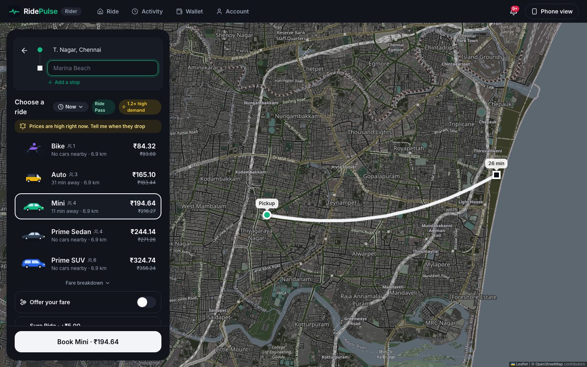

## Highlights

| | |
| --- | --- |
| **Ride, parcel, rental, intercity** | Bike, auto and cars; bike parcels with a recipient delivery code; 1–8 h rentals; outstation one-way or round trips |
| **Fair pricing** | Upfront fares, surge, promos, Ride Pass; **bid your fare** with driver counter-offers; **Sure Ride** (driver in N minutes or ₹30 back); **Fare Lock** for commutes |
| **Safety** | Ride PIN / QR start, **Ride Check** (long stops, off-route, late, lost signal), **Night Safe** mode, trusted contacts, **Guardian mode** (auto live-location to family, shake-to-SOS, fake call, 112), SOS desk, masked calls |
| **Drivers first** | Boosts and tips 100% to drivers, **Fair Share Meter**, real earnings after costs, daily goals, going-home mode, **wellbeing breaks** |
| **Built for India** | ₹ and GST, UPI/cards/cash/wallet, Razorpay, English/Tamil/Hindi with a **chat translation** bridge, IST everywhere |
| **Operations** | Live map, dispatch (sequential and batched, Hungarian assignment), coverage-aware ride catalogue, analytics, audit trail, org chart with 13 roles, manager workspace (tasks, stand-ups, scorecards), alerts that create tasks, morning briefing, demand forecast, fraud review |
| **Data platform** | PostgreSQL → privacy-filtered Parquet lake → DuckDB + dbt star schema with 68 data-quality tests → Dagster, daily |

## Screenshots

| Rider | Driver | Operations |
| --- | --- | --- |
| 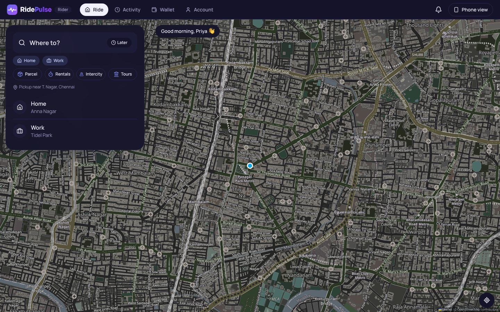 | 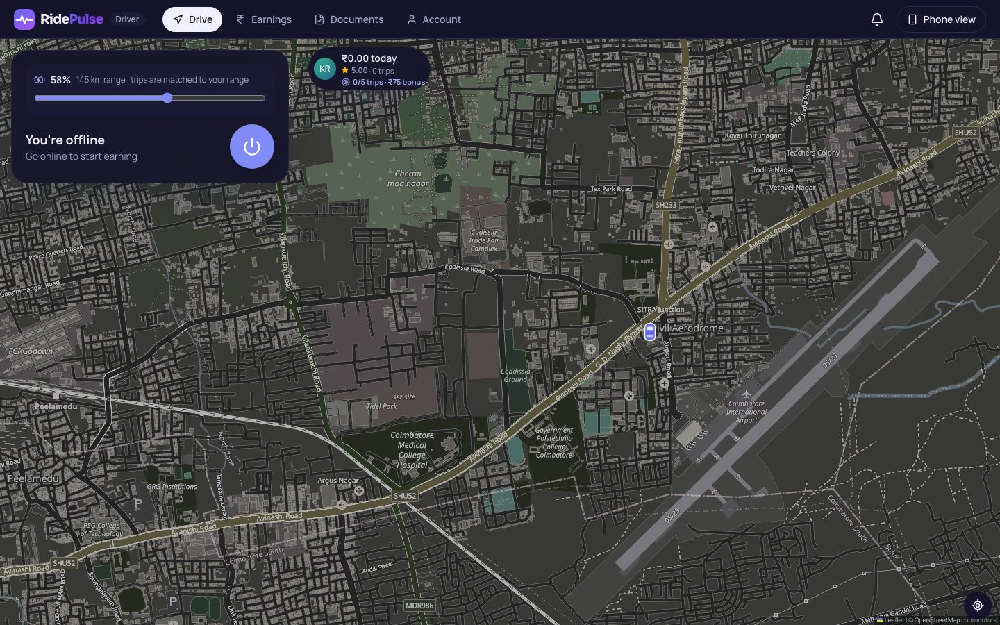 | 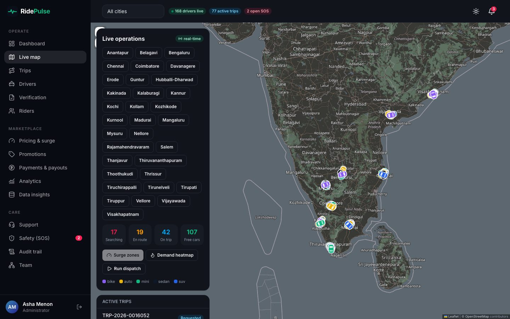 |
| 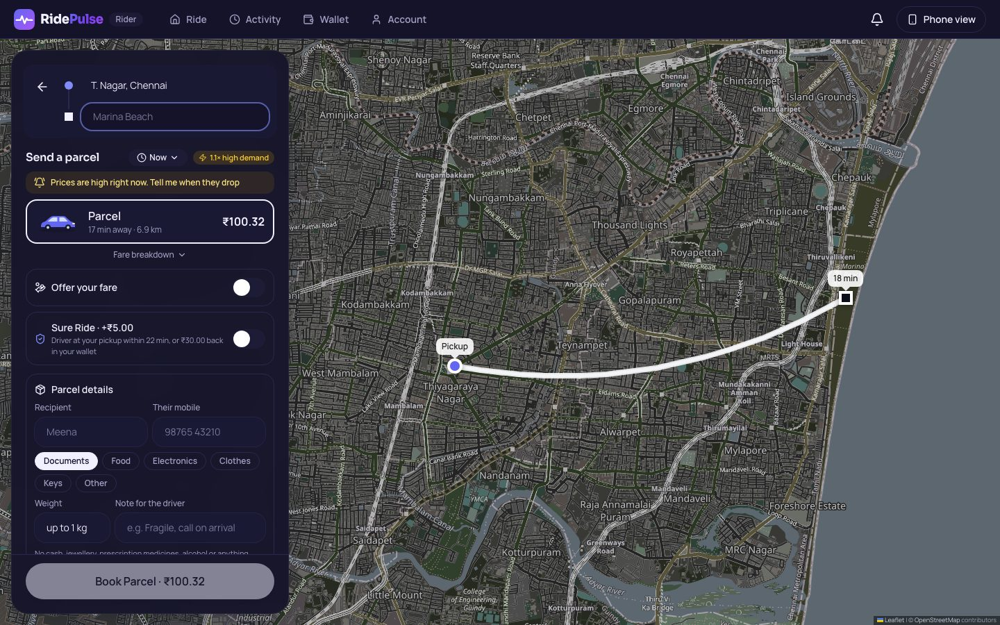 | 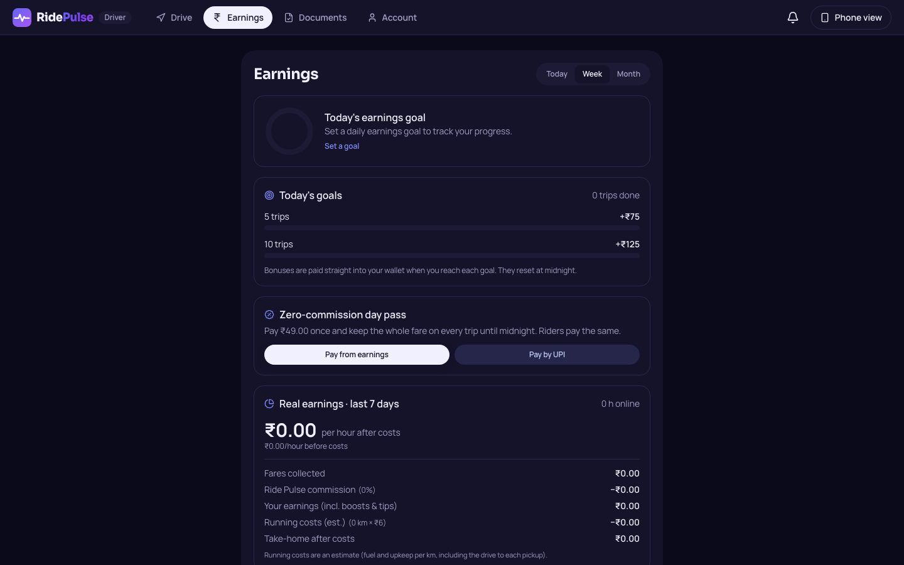 | 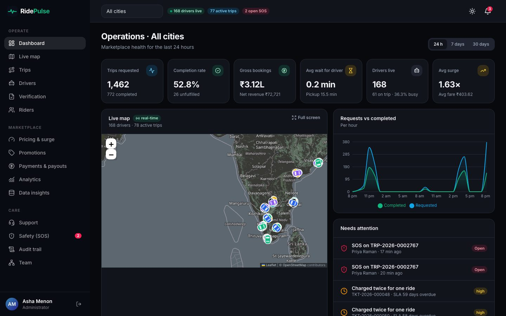 |
| 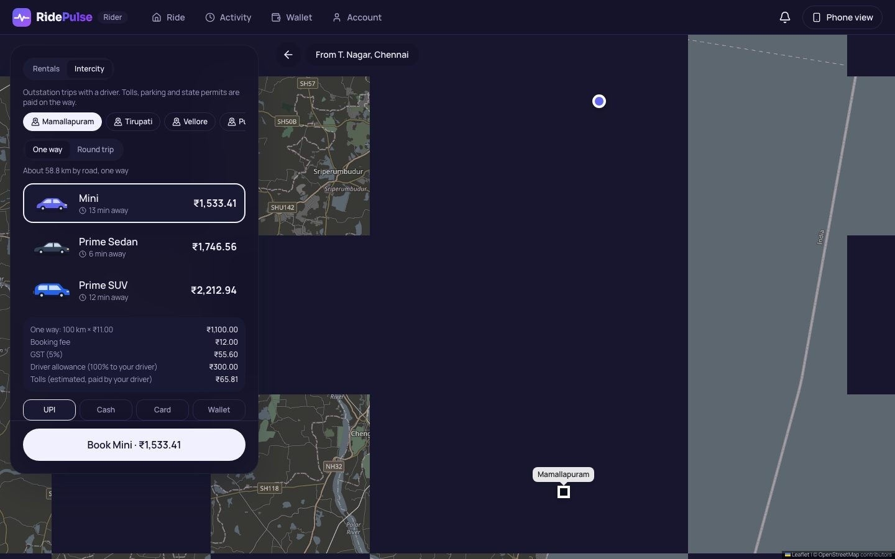 | 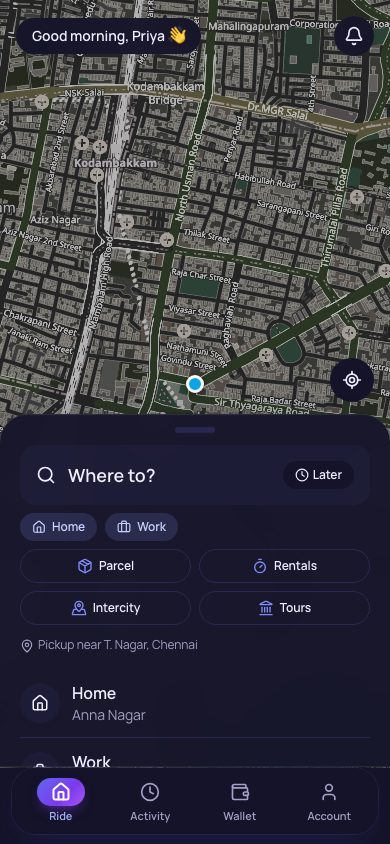 | 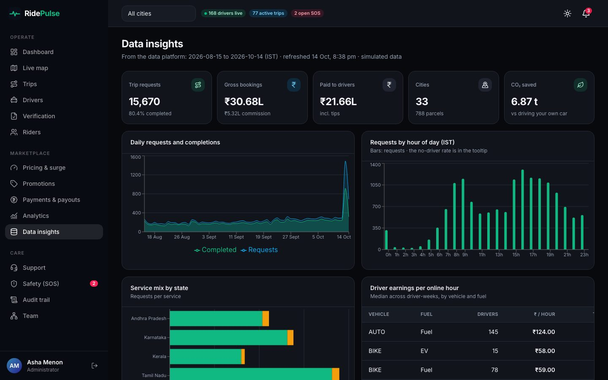 |
| 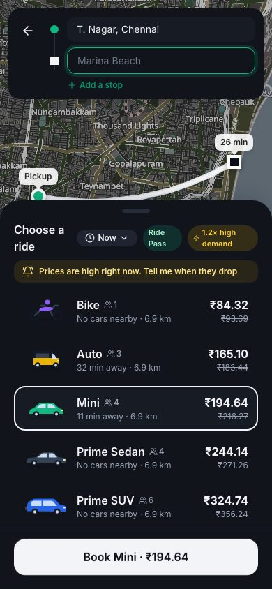 | | 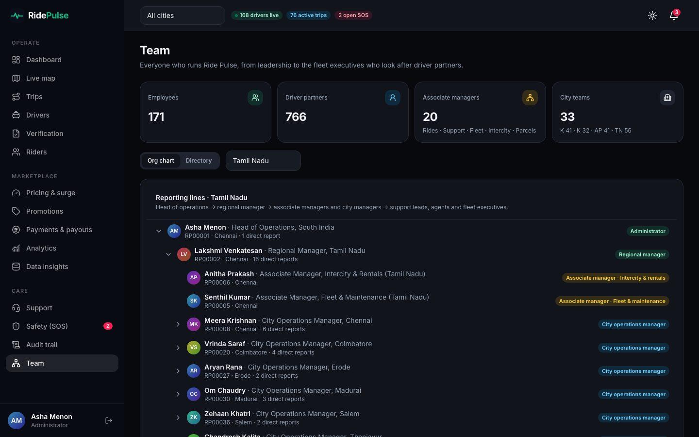 |

Regenerate them with `.venv/bin/python scripts/screenshots.py` while `make dev` is running.

## Architecture

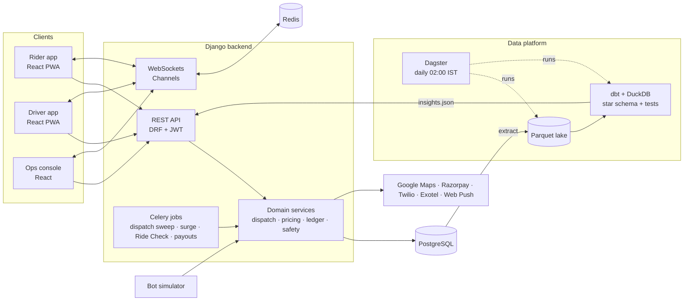

## Stack and quality

| | |
| --- | --- |
| **Back end** | Python 3.12 · Django 5.2 LTS · Django REST Framework · Channels (WebSockets) · Celery |
| **Data** | PostgreSQL 16 (partial unique indexes, BRIN, ArrayField, row locking) · Redis · DuckDB · dbt · Dagster |
| **Front end** | React 19 · TypeScript · Vite · Tailwind CSS · TanStack Query · Leaflet / Google Maps · Recharts |
| **API** | 183 REST operations, JWT auth, OpenAPI 3 docs (Swagger UI and ReDoc) |
| **Quality** | 217 tests (88% coverage) + 9 Playwright browser tests + Locust load test · Ruff · strict TypeScript · dependency audits clean · GitHub Actions · Docker |
| **Ops** | Render blueprint · Sentry · Prometheus `/metrics` · JSON logs · installable PWA |

---

## Quick start

You need Python 3.12 (or [uv](https://docs.astral.sh/uv/)). PostgreSQL and Node.js are installed
into the project's virtualenv, so nothing else is required on the machine.

```bash
make setup     # venv + dependencies, local PostgreSQL, migrations, demo data, React build
make dev       # web server and bot simulator together → http://localhost:8000
```

Or with Docker (Postgres, Redis, web, Celery worker and beat, simulator):

```bash
docker compose up --build
```

### Demo accounts

All demo accounts use the password **`RidePulse@2026`** (created by `make seed`; the login page
has one-click buttons for each).

| Role | Email | Try |
| --- | --- | --- |
| Rider | `rider@ridepulse.dev` | Book a ride from T. Nagar to Marina Beach and watch a bot driver pick you up |
| Driver | `driver@ridepulse.dev` | Go online, tap the map to move, accept a trip, start it with the rider's PIN |
| Operations | `ops@ridepulse.dev` | Live map, trips, driver verification, surge overrides, analytics |
| Support | `support@ridepulse.dev` | Ticket queue, refunds, SOS safety desk |
| Admin | `admin@ridepulse.dev` | Everything, plus the audit trail and the Django admin at `/admin/` |
| Regional manager (Tamil Nadu) | `regional@ridepulse.dev` | The whole state: ops, team, refunds, audit |
| Associate manager · Rides | `rides@ridepulse.dev` | Trips, dispatch, safety |
| Associate manager · Support | `supportlead@ridepulse.dev` | Support queue, refunds, SLA alerts |
| Associate manager · Fleet & maintenance | `fleet@ridepulse.dev` | Driver documents, verification, low-rating alerts |
| Associate manager · Intercity & rentals | `intercity@ridepulse.dev` | Trips and pricing for rentals and outstation |
| Associate manager · Parcels | `parcels@ridepulse.dev` | Parcel trips and support |
| Fleet executive (Chennai) | `fleetexec@ridepulse.dev` | Driver onboarding and verification |

To play both sides yourself, open the rider app in one tab and the driver app in another: each tab
keeps its own sign-in, and opening an app with the wrong account offers a one-click switch. Put the
driver online near the rider's pickup, then book.

---

## What's inside

### Rider app (phone-style)
Map with nearby cars · "Where to?" search over landmarks, areas and saved places · set pickup or
drop by moving the map under a fixed pin (the address updates as it settles) · upfront fares
for Bike, Auto, Mini, Sedan and SUV with ETAs, surge badge and a line-by-line fare breakdown ·
UPI, card, cash or wallet · promo codes · live tracking with the driver's car moving on the map ·
4-digit ride PIN · in-trip chat with the driver (quick replies, unread badge, notifications; bot
drivers answer) · SOS · rating, tags and tips · PDF receipts · wallet top-ups and dues · help
tickets. Bottom sheets drag between peek, normal and full, with the Book button pinned.

### Driver app (phone-style)
Online/offline with compliance checks (expired documents or unpaid dues block going online) ·
surge zones on the map · trip offers with a chime, vibration and a 20-second countdown ring that
turns amber, then red · chat with the rider · navigate, arrive (only within
500 m of the pickup), start with the PIN, complete · cash-collection prompts · earnings by day,
week and month · payouts · document upload and vehicle registration · safety score and
acceptance rate.

**On a laptop or desktop** the rider and driver apps switch to a web layout: a full-screen map
with a side panel (booking, trip status, offers, chat), tabs in a header, and routes framed
beside the panel. Other screens become a centred column. "Phone view" in the header shows the
mobile design instead (remembered per device); phones always get the app layout.

Both apps install as a **PWA** (manifest, icons, a service worker that serves the app shell
offline and never caches live data). Regenerate the icons with `python scripts/make_icons.py`.

### Operations console (desktop)
KPI dashboard · live map of every car and trip (WebSockets with polling fallback) · trip detail
with timeline, GPS route and **dispatch decisions** (who was offered the trip and their ranking
score) · driver verification queue · suspend and reinstate drivers · block riders · surge board
with manual overrides · fare-card editing · promotions · support queue with SLA timers, internal
notes and refunds · SOS desk · payouts and a live ledger integrity check · analytics with a demand
heatmap · CSV export · field-level audit trail.

---

## How it works

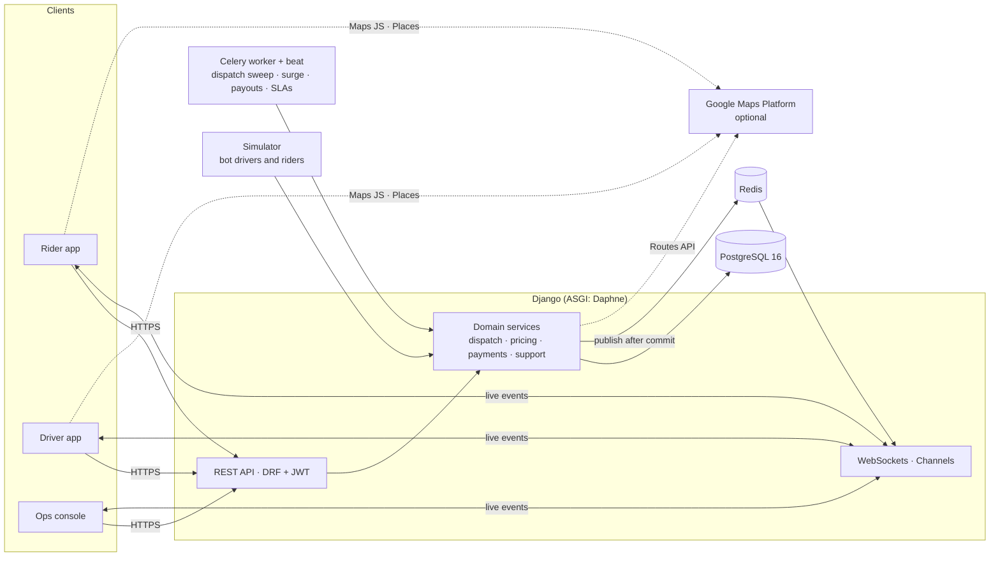

Business logic lives in plain service functions (`apps/*/services.py`); API views, the simulator,
Celery tasks and the demo seeder all call the same functions, so behaviour is identical everywhere.

### Trip lifecycle

```
REQUESTED ─accept─▶ DRIVER_ASSIGNED ─arrive─▶ DRIVER_ARRIVED ─PIN─▶ IN_PROGRESS ─▶ COMPLETED
    │  ▲                  │                        │
    │  └─driver cancels───┘ (re-dispatched)        │
    ├─▶ NO_DRIVER_FOUND (5-minute timeout)         │
    └──────────────────────────────────────────────┴──▶ CANCELLED (fees by policy)
```

Every transition goes through one state machine (`apps/rides/workflow.py`) and is recorded on the
trip timeline and in the audit trail.

### Dispatch
* **Sequential (default):** candidates come from an index-friendly bounding box on online drivers
  plus an exact haversine distance computed *inside PostgreSQL*. They are ranked by pickup ETA plus
  small "virtual minute" penalties for low ratings, low acceptance and poor safety scores. The best
  driver gets a 20-second offer; declines and timeouts pass it to the next.
* **Batched:** each sweep solves one assignment problem over all open requests and free drivers in
  a city with the **Hungarian algorithm** (`apps/rides/hungarian.py`), minimising total pickup time
  instead of greedily matching one request at a time. It's tested against brute force.
* **Never double-booked:** partial unique indexes allow one active trip per rider and per driver,
  and one pending offer per driver, so even racing workers can't break the rules.

### Pricing
`fare = max(base + km × rate + minutes × rate + paid waiting, minimum) × surge + fees − promo + 5% GST`.
The engine (`apps/pricing/fare.py`) is pure and explains itself line by line. Fares are
**upfront**: the quoted price stands unless the real route is more than 20% longer, or 30% slower,
than estimated. Promotions are funded by the platform, so the driver's earning never shrinks.
**Surge** comes from demand (recent requests) against supply (free drivers) in each zone, smoothed
and capped at 3×; operations can override it for events.

### Money
Every rupee moves through a **double-entry ledger**: each transaction's entries sum to zero, and
wallet balances only change through entries. `GET /api/v1/ledger/` re-verifies both invariants
from the database. Cash trips leave the platform's share as driver dues; failed card payments
become rider dues; payments use **idempotency keys**; weekly payouts can fail and reverse cleanly.

### Real time
Services publish events only **after the database transaction commits** (`transaction.on_commit`),
so a client never hears about a state it can't read. Trip, driver and ops channels authenticate
with the session cookie or a JWT.

Without Redis, events still cross processes: they're published with PostgreSQL **`LISTEN/NOTIFY`**
(`apps/realtime/relay.py`), and each web process relays what it hears to its sockets. So a bot
driver moving in the simulator process reaches the rider's map in milliseconds. With `REDIS_URL`
set, the Redis channel layer does this instead. Every screen also polls as a fallback.

On the map, cars **glide** between GPS updates (each move lasts as long as the gap between
updates, so motion is continuous) and **turn smoothly**. During a trip the car is snapped onto the
route, the part already driven disappears, and the ETA counts the road that's left ("4.6 km left ·
drop by 5:49 pm"). Simulated drivers follow the same route line riders see. Nearby cars carry a
daily-rotating anonymous key, so they can be animated without revealing which driver is which.

### PostgreSQL features used
Partial unique indexes and partial indexes · BRIN indexes for append-only GPS pings and audit logs
· `ArrayField` · `DISTINCT ON` · `generate_series` + `FILTER` for gap-free time series · geohash
prefixes for demand heatmaps · haversine distance in SQL · `INSERT … ON CONFLICT … RETURNING` for
gap-free reference numbers · `SELECT … FOR UPDATE (SKIP LOCKED)` in dispatch.

---

## Google Maps integration

The platform works out of the box with **OpenStreetMap** and built-in route estimates. Add Google
Maps keys and it switches to Google, with no code changes:

| | Without keys | With Google keys |
| --- | --- | --- |
| Map tiles | OpenStreetMap (Leaflet) | Google Maps (`@vis.gl/react-google-maps`), light and dark |
| "Where to?" search | Ride Pulse landmarks and areas | **Google Places Autocomplete**: any address in India |
| Dropped pins | Nearest landmark or area | **Google reverse geocoding** |
| Trip distance and ETA | Straight line × 1.3 road factor, time-of-day speed profile | **Routes API**: real roads, live traffic |
| Route on the map | Smooth arc | **Actual road polyline** (stored with the trip) |

**Setup**
1. In the [Google Cloud console](https://console.cloud.google.com/google/maps-apis), create a
   project with billing, and enable *Maps JavaScript API*, *Places API (New)*, *Geocoding API* and
   *Routes API*.
2. Create two keys:
   * a **browser key** restricted to those browser APIs and your site's referrers
     (`http://localhost:8000/*`);
   * a **server key** restricted to the Routes API and your server's IP.
3. Put them in `.env` as `GOOGLE_MAPS_BROWSER_KEY` and `GOOGLE_MAPS_API_KEY` and restart.

**Built to fail safely.** If the server key fails or is slow (2.5 s timeout), trips fall back to
the built-in estimate. If Google rejects the browser key at runtime (bad key, billing disabled, or
an unauthorised domain), the apps switch to OpenStreetMap instead of breaking. Route lookups are
cached for 5 minutes per origin and destination.

**Cost.** Billing accounts in India get 70,000 free events per month for Dynamic Maps,
Autocomplete, Geocoding, Compute Routes (Essentials) and Route Matrix, and 35,000 for
traffic-aware Compute Routes (Pro). Beyond that, prices start at about $0.85–$3 per 1,000
([India pricing](https://developers.google.com/maps/billing-and-pricing/pricing-india); elsewhere
the free caps are 10,000 and 5,000, see
[global pricing](https://developers.google.com/maps/billing-and-pricing/pricing)). A portfolio demo
stays well inside the free tier. Check the current price lists before running real traffic.

---

## API

* Swagger UI: <http://localhost:8000/api/docs/> · ReDoc: `/api/redoc/` · schema: `/api/schema/`
* Authenticate with `POST /api/v1/auth/token/` and send `Authorization: Bearer <access>`.
* Errors share one envelope: `{"error": {"code", "message", "field", "details"}}`.

```bash
TOKEN=$(curl -s -X POST localhost:8000/api/v1/auth/token/ -H 'Content-Type: application/json' \
  -d '{"email":"rider@ridepulse.dev","password":"RidePulse@2026"}' | python3 -c 'import sys,json;print(json.load(sys.stdin)["access"])')

curl -s -X POST localhost:8000/api/v1/fares/estimate/ -H "Authorization: Bearer $TOKEN" -H 'Content-Type: application/json' \
  -d '{"pickup":{"lat":13.0418,"lng":80.2341},"dropoff":{"lat":13.05,"lng":80.2824}}'
```

Access is **capability-based**: roles map to capabilities (`trips.manage`, `payments.refund`, …)
in one place (`apps/accounts/roles.py`), views declare what each action needs, and anything
unmapped is denied. Riders and drivers only ever see their own records.

### More rider features
* **Share trip:** a public "follow my ride" link (`/track/<token>`) shows the car, driver and
  plate live, with no login; no phone numbers, PIN or fare, and it expires an hour after the ride.
* **Schedule a ride** up to 7 days ahead. A background job (`dispatch_scheduled_rides`, every
  minute, `SKIP LOCKED` so several workers never double-book) turns it into a normal trip
  request eight minutes before pickup, or tells the rider why it couldn't.
* **A stop on the way:** fares, distance and ETA cover both legs plus a stop allowance; road
  polylines are joined; bots drive through the stop.
* **Referrals:** invite links pre-fill the code; after the friend's first ride both wallets get
  ₹50 from the promotions budget, as one balanced ledger transaction, exactly once.
* **Boost and tips:** while searching, riders can add ₹10/20/30/50 (up to ₹100). It goes 100%
  to the driver (no commission or GST), widens the search, starts a new dispatch round so
  drivers who passed are asked again, and gives the request another minute. A tip promised at
  booking shows on the driver's offer and is collected with the fare (cash in hand for cash
  rides). Bot drivers say yes more often to boosted or tipped rides.
* **Invoice email after payment** (like Rapido): a numbered GST invoice (`INV-<year>-000001`)
  with the fare breakdown, route and times, driver and plate, payment, and the PDF attached,
  sent when the fare is paid (or once unpaid dues are cleared). Riders can view it in the app
  and send it again; phone-only riders add an email in Account.
* **Razorpay** for wallet top-ups (test or live keys in `.env`): the server creates the order,
  Checkout takes the payment, and the wallet is credited only after the HMAC signature is
  verified, by the browser callback or the `payment.captured` webhook, whichever is first.
* **Ride preferences and favourite drivers:** quiet ride, AC on, extra luggage and "woman
  driver preferred" (women drivers nearby are offered the trip first). Favourite drivers get a
  head start in dispatch when they're close.
* **Ride Pass:** ₹99 for 30 days; no booking fee and 10% off every ride (up to ₹30 a ride).
* **Split fare:** after a paid ride, ask friends by phone number; their share lands in the
  rider's wallet when they pay.
* **Price-drop alerts:** during surge, "tell me when prices drop" notifies the rider once
  (with a ready-to-book link) when the zone's surge ends, for up to 2 hours.
* **Lost and found:** up to 7 days after a ride the rider reports an item; the driver answers
  Found / Not in my car, masked calls reopen for 24 hours, and a support ticket tracks it until
  the item is handed back.
  * Phones, wallets, keys and documents are valuables, with urgent tickets.
  * A found item can come back as a **bike parcel** ("Deliver it to me"), paid like any parcel.
    It's marked returned when delivered.
  * An item nobody collects within 7 days goes to the **city hub**, and is donated after 30 days
    there, with notice to the rider.
  * Drivers who haven't answered within 12 hours get a reminder.
  * Ops → **Lost & found** runs it all.
* **Tamil and Hindi:** the rider and driver apps switch language from Account (kept on the
  device); anything not yet translated shows in English.

* **Safety+ (Ride Check and Night Safe mode):** every minute the server watches trips in
  progress and asks "Is everything OK?" when the car has stopped for a while, gone well off the
  route, is running very late, or its location went silent (`rides.safety`). "Get help", or no
  answer within 3 minutes, opens a safety incident like SOS and alerts the rider's trusted
  contacts. Night Safe mode (10 pm – 6 am and "woman driver" rides) uses stricter limits,
  texts the live link to trusted contacts (up to 3: every ride, night rides, or only when shared),
  stops the driver ending the trip away from the drop unless the rider confirms, and adds an
  "I'm home safe" check-in. Ops see every check in the Safety desk.
* **Guardian mode** (`rides.guardian`; opt-in for any rider, in Account → Safety): if something
  goes wrong, the rider's live location goes to their loved ones without them doing anything.
  * **Triggers**: SOS, shaking the phone hard three times (a 5-second countdown, then SOS), a Ride
    Check firing or going unanswered, or "Share location".
  * **What contacts get**: an SMS (and an in-app alert if they use Ride Pulse) with what happened,
    the car and driver, a Google Maps pin, and a live page (`/safe/<token>`). The page follows
    the rider's phone, and the car when the phone is quiet.
  * **Phone gone quiet**: if nothing new arrives for 5 minutes, contacts get the last known
    location again (every 10 minutes, at most 3 times).
  * **It ends** on "I'm safe" (or "I'm OK" to a Ride Check), when the safety desk closes it, or
    after 12 hours. Contacts are told, and the page stops showing a location.
  * Switching Guardian mode on is the rider's recorded consent to share (DPDP).
  * **Also**: a fake incoming call from a name the rider chooses, and one-tap 112 in the SOS
    sheet. The safety desk lists open alerts with "what family sees".

* **When a ride type isn't available:** bike taxis run 5 am – 11 pm (service hours per ride
  type). If nobody of that type is near the pickup, or it's closed, the booking screen suggests
  the closest alternative (enough seats first, then a similar price) or lets the rider search
  anyway with a boost; after "no drivers available" the trip screen offers the same switch.
* **Bid your fare (like inDrive):** riders can offer 85% – 150% of the upfront price. Drivers
  accept, or counter with +₹10/20/30; counters appear live on the rider's search screen for two
  minutes while the search continues. The agreed difference is the driver's, outside commission.
* **Sure Ride:** for ₹5, "a driver at your pickup within N minutes or ₹30 back" (N = nearest
  ETA + 4). Late arrivals and no-driver-found are refunded to the wallet automatically.
* **Fair Share Meter:** every finished trip shows where the money went (driver, commission,
  each fee, discount, GST). Drivers see their real hourly earnings after estimated running costs.

* **Parcel delivery (like Rapido Parcel):** "Send a parcel" on Home. Bike drivers carry
  packages up to 10 kg (they can opt out). The sender adds the recipient, item type and weight;
  at pickup the recipient gets an SMS with a live tracking link and a 4-digit delivery code, and
  the driver can only mark it delivered with that code (wrong tries are counted and capped).

* **Hourly rentals:** a car and driver for 1/2/4/8 hours (10 km per hour included); no fixed
  drop, and extra km and minutes are added at the end (`rides.packages`).
* **Intercity (outstation):** from a served city to anywhere 40–600 km away, one-way or round
  trip for 1–7 days. Per-km pricing (minimum 100 km one-way, 250 km a day for round trips) plus
  a ₹300/day driver allowance that is all the driver's; car drivers can opt out of intercity.
  Shown up front and passed straight to the driver, with no commission and no GST:
  * estimated **tolls** (about 70% of the route on tolled highways)
  * an **interstate permit** when the destination is in another state
  * a **night driving allowance** when the drive runs between 10 pm and 6 am

* **Fare Lock:** from a finished ride, lock that route's normal price for a week (₹49) on
  chosen weekdays within an hour of the same time; surge never applies and Ride Pulse covers
  the difference as a discount, so the driver earns the same.
* **Language Bridge:** each user's app language is saved; chat messages arrive in the other
  person's language. Quick replies and common phrases use a built-in English/Tamil/Hindi
  phrasebook; free text is translated by Google Cloud Translation when
  `GOOGLE_TRANSLATE_API_KEY` is set (otherwise the original is shown).
* **Eco score:** each trip records CO₂ saved versus driving your own petrol car (by vehicle
  and fuel; EVs save most). 1 eco point per 100 g; 100 points = ₹10 in the wallet. Riders can
  prefer electric vehicles, which get a dispatch head start.

* **33 cities across South India:** Tamil Nadu (Chennai, Coimbatore, Madurai, Tiruchirappalli,
  Salem, Tirunelveli, Vellore, Erode, Thoothukudi, Thanjavur, Tiruppur), Kerala (Kochi,
  Thiruvananthapuram, Kozhikode, Thrissur, Kannur, Kollam), Karnataka (Bengaluru, Mysuru,
  Mangaluru, Hubballi-Dharwad, Belagavi, Kalaburagi, Davanagere) and Andhra Pradesh
  (Visakhapatnam, Vijayawada, Guntur, Tirupati, Nellore, Kakinada, Rajamahendravaram, Kurnool,
  Anantapur), each with zones, airports, landmarks and fares scaled to the city
  (`apps/geo/city_data_south.py`; coordinates are approximate).
* **The organisation:** a Head of Operations; a regional manager per state; five associate
  managers per state (Rides, Support, Fleet & maintenance, Intercity & rentals, Parcels), each
  with permissions for their line of business; a city operations manager per city with support
  leads, agents and fleet executives; and every driver partner assigned a fleet executive. The
  ops console's **Team** page shows the org chart and staff directory. `manage.py grow_network`
  tops up drivers, riders and staff in every city (it also runs at the end of `make seed`), and
  `manage.py simulate --cities all` runs bots everywhere (the default is the 9 busiest cities).
* **Manager workspace (Work page):** work flows down the org chart. Managers give tasks to one
  person or their whole team (deadline, priority, an optional target like "verify 20 drivers"),
  ask "what's the status?", give guidance in a check-in thread, move deadlines or hand work to
  someone else. Overdue tasks alert both sides once. Daily stand-ups repeat every weekday;
  afterwards the organiser records attendance and notes, and action items become tasks. The
  team dashboard has scorecards built from real output (tickets resolved, driver documents
  reviewed, tasks on time, meetings attended). Simulated staff accept invites, start work,
  answer status requests and finish (some late); anyone who signed in recently is left alone.
  `manage.py seed_work` adds a week of demo tasks and stand-ups to an existing database.
* **Ops intelligence** (`apps/intelligence`, the Intelligence section of the ops console):
  * **Scorecards** add ticket reply time, SLA met, document review time and a "needs guidance"
    flag (judged only once there's enough work: 3+ tasks or tickets).
  * **Alerts that create tasks:** every 5 minutes each city's last hour is compared with its own
    normal level (cancellations, riders finding no driver, SOS spikes, tickets past SLA). An
    alert opens a task for the manager who owns the problem, assigned by their manager, and
    closes itself when the numbers recover.
  * **Morning briefing** at 8 am: yesterday's trips, bookings and commission against the same
    day last week, the cities to watch, safety, support SLA, new drivers, open alerts, fraud
    cases and how the team did on its tasks.
  * **Demand forecast:** the next hour per zone, from the same hour on the same weekday over four
    weeks (recent weeks weigh more) blended with the last hour's real demand. Zones short of
    drivers are shown on a map, and free drivers nearby get a nudge (at most every 45 minutes;
    the driver app shows "Busy in the next hour"). Accuracy is back-tested on the last 72 hours
    against two simple guesses (history only, and "same as last hour").
  * **Fraud review queue:** hourly rules over two weeks of trips: GPS spoofing, route padding,
    the same rider and driver again and again, promos on very short trips, and referral
    farming. Each case has a 0-100 score and the trips behind it; reviewers confirm (and can
    suspend the driver or block the rider in one step) or dismiss. `manage.py seed_intel` plants
    demo patterns.

### More for riders: stops, accessibility, teens, companies, weather
* **Up to three stops** per trip (`stops` in the API; the older single `stop` still works), priced
  over the whole route, shown on every map and covered by Ride Check.
* **Accessible rides:** riders save their needs in Account. Wheelchair users are only ever sent
  wheelchair-accessible cars (bikes and autos show as unavailable, with the reason); riders who
  need help boarding, or are blind or low vision, get drivers trained in boarding assistance
  first and 5 extra minutes of free waiting; deaf riders' drivers see "message, don't call"
  (the call button is hidden).
* **Teen accounts** (13-17): a parent links their teen's account; rides are paid by the parent
  (a family profile with a monthly limit), blocked during a curfew (10 pm - 6 am by default),
  cars and autos only, matched only with experienced top-rated drivers (4.8+, 100+ trips), and
  shared with the parent live (assigned with the tracking link, started, arrived).
* **Corporate portal** (`/ride/business/<id>`, demo `business@ridepulse.dev`): travel policy
  (ride types, hours, a fare cap), cost centres with per-employee defaults, travel admins, spend
  by month, employee, cost centre and ride type, a consolidated monthly GST invoice (PDF), and
  the company's own webhook for its employees' trips. 12 companies in the demo; simulated
  employees book about half their rides on their company.
* **Weather and events:** live weather from Open-Meteo (no key) every 30 minutes, or a seasonal
  simulation offline (north-east monsoon for Tamil Nadu and Andhra, south-west for Kerala and
  Karnataka). Rain lifts the demand forecast (up to +40%) and the simulator's request rate; big
  events (matches, concerts, festivals) add the crowd's trips near the venue before the start
  and after the end. Riders see rain and event alerts on Home; drivers see why a zone will be
  busy; ops manage events on Weather & events.

### The driver business (`apps/fleet`)
* **Weekly statements with TDS:** every Monday, before payouts, each driver who worked gets a
  statement (trips, fares, commission, tips, bonuses, fleet share, net) and a PDF. Ride Pulse is
  an e-commerce operator under section 194-O: 0.1% of gross fares is withheld as TDS (5% without
  a PAN on file, section 206AA) into `tax:tds_payable`. Ops > TDS has the quarterly report and a
  CSV for the return (Form 26Q).
* **Fleet owners** (role `FLEET_OWNER`, portal at `/fleet`, demo `owner@ridepulse.dev`): partners
  who own cars and employ drivers keep a share (15-25%) of their drivers' trip earnings, posted
  through the ledger on every trip (boosts and tips stay with the driver) and paid weekly. 42
  owners across all 33 cities, each with a fleet executive as account manager.
* **Vehicle upkeep:** odometer from trips, service due by distance (bike 3,000 km, auto 5,000,
  cars 10,000), insurance, permit and fitness expiry. Drivers and owners are warned ahead;
  expired insurance keeps a car offline. Drivers and owners log services.
* **Vehicle health** (Ops → Vehicle health, the driver's Vehicle care card, the owner portal):
  every car is *on the road*, *needs attention*, *overdue*, *in the workshop* or *off the road*.
  * A **daily safety check** (10 items) before the first ride. A failed brake, tyre, light or
    seat belt takes the car off the road.
  * **Faults** come from drivers, riders ("Something wrong with the car?" after a ride), the daily
    check, owners and ops. A breakdown or accident is critical.
  * A **breakdown before pickup** sends the ride to another driver. A **breakdown mid-ride** ends
    it at no charge and opens a high-priority ticket.
  * **Service records** keep the kind of work, parts with costs, labour and the invoice number.
    A repair closes the faults it fixed and puts the car back on the road; cost per km is shown.
  * A car off the road or in the workshop can't go online. Owners and ops can send a car to the
    workshop and bring it back.
  * In the demo, bot drivers do the daily check, sometimes find faults, and the "workshop"
    repairs them a few hours later.
* **EVs:** range-aware dispatch (a trip is offered only if the battery covers pickup + trip + a
  15 km reserve), battery level from the driver app (the simulator drains and recharges), low
  battery alerts with the nearest suitable chargers (123 stations: Tata Power, Statiq,
  ChargeZone, Jio-bp, Zeon, Ather Grid, Kazam).
* **Incentive quests:** ops create tiered quests (city or state, ride types, peak hours, minimum
  rating, budget) without code. Rewards are paid into wallets as tiers are reached, and a quest
  ends itself when the budget runs out.
* **Airport queue:** drivers inside an airport zone join a virtual first-come-first-served line
  (leaving for more than 5 minutes drops them); airport pickups are offered to the line first.

### More driver features
* **Daily goals:** ₹75 bonus at 5 trips and ₹125 more at 10, paid into earnings through the
  ledger (`DRIVER_GOALS`).
* **Going-home mode:** twice a day, for an hour, only trips that take the driver at least 1 km
  closer to their saved home are offered.

* **Driver Wellbeing:** after 6 hours of driving (pauses under 20 minutes don't count as rest)
  drivers get no new offers and are taken offline for a 20-minute break, with a warning 30
  minutes before; a proper break after 4+ hours pays a ₹10 rest bonus once a day.
  * **At most 12 hours online in any 24**, then 8 hours off.
  * After **6 working days** in a week, a nudge to take a day off.
  * On a break, the app suggests nearby places to rest: malls and stations, and chargers for EVs.

### Production essentials
* **Phone login with SMS codes** (`/api/v1/auth/otp/…`): 6-digit codes stored only as HMACs,
  5-minute expiry, 5 tries, resend every 30 s and at most 5 an hour per number; new numbers
  sign up with just a name. SMS goes through Twilio or MSG91 (`SMS_BACKEND`); in development
  the code is logged and shown in the app.
* **Masked calling:** riders and drivers never see each other's number (only staff do). Calls
  go through Exotel click-to-call when configured (demo mode otherwise), are rate limited, and
  are logged on the trip for safety reviews.
* **Pickup verification** (`apps/rides/pickup.py`):
  * *Scan to start:* the rider shows a QR code that rotates every 30 s (an HMAC of the trip,
    its secret PIN and the time window), the driver scans it with the phone camera
    (BarcodeDetector, or jsQR on Safari). A screenshot stops working within a minute.
  * *The PIN is the fallback,* shown only once the driver is within 500 m, hidden until tapped,
    and read aloud on request. Five wrong PINs or codes lock the trip and alert the rider.
  * *Is this your car?* The rider checks the plate; "no" raises a safety incident at once.
  * *Together at the pickup:* the trip only starts with the driver at the pickup and, when the
    rider shares location, both phones within 150 m.
  * *After the start:* if the rider's phone and the car drift over 1 km apart, both are alerted
    (once). Locations from a device that's clearly elsewhere (a laptop demo) are ignored.
* **GPS-spoofing guard:** impossible jumps (over 1 km at over 150 km/h) aren't billed, and the
  trip is flagged for review.
* **Real driver GPS:** the driver app can follow the phone's location (`watchPosition`, sent
  every 15 m or 4 s) and keeps the screen awake while online.
* **Push notifications** (standard Web Push with VAPID keys, no Firebase account): urgent trip
  offers that expire with the offer, and trip updates for riders, even with the app closed.
  `python manage.py generate_vapid_keys`.

---

## Deploy

**Render (free plan):** push the repo to GitHub, then in Render choose *New → Blueprint* and pick
the repository. `render.yaml` creates the web service (Docker) and a PostgreSQL database; the
start script migrates, seeds demo data and runs the bot simulator next to the server. Real-time
updates work without Redis thanks to the PostgreSQL relay. Optional keys (Google Maps, Razorpay,
Sentry, metrics token) are set in the Render dashboard, never in git.

**Anywhere with Docker:** `docker compose up --build` runs the full stack (Postgres, Redis, web,
Celery worker and beat, simulator).

### Trust and compliance (`apps/trust`)
* **Personal data rights** (built along the lines of India's DPDP Act, 2023): optional uses
  (offers, sharing trips with trusted contacts) are opt-in, as easy to withdraw, and every change
  is kept with the notice version. "Download my data" builds a JSON archive (7-day link).
  "Delete my account" waits 7 days (cancellable), then erases personal details; trips, fares and
  ledger entries stay without a name because tax law needs them, and deletion is refused while a
  trip is active or money is owed. Corrections and grievances get a reference and a 30-day
  deadline in the ops privacy queue. A daily job removes data past its retention period (chats
  after 180 days, recordings after 90 unless a case is open, notifications and the security log
  after a year, expired export files).
* **Appeals:** suspended drivers, blocked riders and anyone judged in a fraud case can appeal.
  The **reviewer must be someone other than the person who made the decision**; accepting an
  appeal reverses it in the same step (reinstate, unblock, fraud case dismissed), audited.
* **Insurance claims:** every ride carries accident cover. The rider or driver files within 7
  days with photos; the claims desk sends it to the insurer and approves (paid to the wallet from
  `external:insurer` in the ledger) or rejects, never on their own claim.
* **Support quality:** riders rate resolved tickets 1-5 (CSAT, also on agent scorecards and the
  "needs guidance" flag); agents insert saved replies with the name, ticket and trip filled in;
  a help centre for riders and drivers with search, "was this helpful?" and a count of questions
  solved without a ticket. Promotions go only to riders who opted in.

### Reliability and security (`apps/reliability`)
* **Transactional outbox:** trip requested/completed/cancelled, refunds, payouts, SOS and fraud
  cases are written as events in the same database transaction as the change, so an event is
  never lost after a commit and never sent for a change that rolled back. A relay (every 10 s,
  `SELECT … FOR UPDATE SKIP LOCKED`) fans them out to **webhooks**: HMAC-SHA256 signed, an event
  id for idempotent consumers, exponential backoff, a dead-letter queue with replay, and
  endpoints switched off after 50 failures in a row. Deliveries are claimed with a lease and
  sent outside any transaction (network calls never hold database locks). Events carry ids,
  money and places, not personal data. Ops > Platform health shows lag, deliveries and the
  built-in demo receiver.
* **Abuse protection:** five wrong passwords in 15 minutes lock an account for 15 minutes
  (state in PostgreSQL, so it holds across app servers; the owner is emailed; ops can unlock).
  Rate limits per IP, per user and per endpoint (login, OTP, booking, GPS, fare estimates);
  SOS is never rate limited. Every lock and rate-limit hit is in the security log.
* **Works offline:** GPS fixes and chat messages taken without signal are kept on the phone
  (IndexedDB) and replayed in order when it reconnects (`driver/location/batch/` keeps each
  fix's own timestamp, up to 30 minutes old). Key screens (profile, active trip, earnings,
  quests, statements, wallet) open from the last good copy; an offline banner says what's
  pending; everything is wiped on sign-out or sign-in on a shared phone.
* **API contract tests:** `docs/api/openapi.json` is the committed contract. The suite fails on a
  breaking change (removed endpoint or response field, changed type, newly required request
  field, removed enum value); additions are fine. `make contract` refreshes it on purpose.
* **Chaos tests** (`tests/integration/test_chaos.py`) break one dependency at a time (the
  real-time layer, the task broker, Google Maps and Translate, the payment gateway, a partner's
  webhook) and check that rides still complete and money still balances. They found and fixed
  three real bugs: a gateway outage crashed trip completion, a broker outage failed requests
  after their data was saved, and a non-HTTP network error could crash webhook delivery.
* **CI** (`.github/workflows/ci.yml`): lint, migrations, OpenAPI warnings, the API contract,
  tests with coverage, the React build, Playwright browser tests, a dependency vulnerability
  audit (pip-audit, npm audit), the dbt project, and the Docker image.

### Compliance with India's Aggregator Guidelines (`apps/compliance`)

Ops → **Compliance**: each state's checks, and the drivers and vehicles to fix.

* **Enforced as money moves:**
  * Surge never goes above the state's cap (2× by default), even with a manual override.
  * Cancellation fees are at most 10% of the fare and ₹100.
  * Drivers keep at least 80% of the fare (the commission is checked).
* **Drivers** can't go online without police verification and induction training. Ops record
  the police certificate number, and training is refreshed every 12 months.
* **Vehicles** older than 8 years are listed for replacement.
* **Driver Academy** (driver app → Account → Driver Academy): short courses with a quiz (pass at
  80%). Courses: induction (required, refreshed yearly), women's safety and respectful conduct,
  first aid, EV driving, and helping riders with disabilities.
  * Passing induction is what records the training the guidelines require.
  * Passing the accessibility course makes a driver assist-trained, so dispatch prefers them for
    riders who need help.
  * The app never receives the answers; the driver sees what to review after a fail.
* The limits come from the 2025 central guidelines as we understand them. Each state notifies
  its own rules, so **check them** and override per state in `AGGREGATOR_RULES`
  (e.g. `{"Karnataka": {"surge_cap": "1.5"}}`).

### Two-step sign-in for staff (`accounts.two_factor`)

Ops → **Security**.
* After the password, staff with two-step on enter a 6-digit code from an authenticator app
  (Google or Microsoft Authenticator). It works for phone-code sign-in too.
* Codes are standard TOTP (RFC 6238, checked against the RFC's own examples), implemented in
  plain Python. A code can't be used twice, and wrong codes count towards the account lockout.
* Turning it on gives 10 one-time recovery codes, stored hashed.
* It's required for admins and managers: they see a reminder on every ops page until they turn
  it on, and Security lists who still hasn't.
* The demo logins don't have it on, so the demo still signs in with one click.

### City P&L (`analytics.pnl`)

Ops → **City P&L**, by month.
* **From the ledger, exactly:** commission, booking fees, promotion spend and refunds. Each
  transaction counts for the city of its trip, and money with no trip (Ride Pass, some bonuses)
  is shown on its own line.
* **Labelled estimates:** card gateway fees (2% of card fares; UPI has no merchant fee in
  India) and support at ₹45 a ticket. Both can be changed in `PNL_ASSUMPTIONS`.
* GST is shown separately (owed to the government).
* The bottom line is a **contribution**, before salaries, marketing, offices and technology.
* Finance can set a monthly revenue and promotions budget per city, and see actuals against it.

### GST e-invoices and returns (`payments.gst`)

Ops → **GST**, by month.
* **GSTR-1 data:** business invoices by buyer GSTIN (B2B) and consumer rides summarised by state
  (B2CS), as JSON or CSV.
* **E-invoices:** each business trip gets the government's **INV-01 e-invoice JSON** (seller and
  buyer details, SAC, CGST + SGST). Missing buyer billing details are flagged rather than
  invented.
* **Not included:** getting an IRN needs a GST account with a GST Suvidha Provider (an outside
  account, like Maps); these are the files you'd upload. Cancellation fees, which also carry GST,
  aren't in the return yet.
* **Assumptions to confirm with a chartered accountant:** SAC 996412; place of supply is where
  the ride starts; registration in each state (so CGST + SGST, not IGST).

### NPS surveys (`trust.nps`)

Riders (after 3 trips) and drivers (after 10) are asked "How likely are you to recommend Ride
Pulse?" (0–10, optional comment) at most every 90 days; "Not now" waits 30 days. Ops → NPS shows
NPS (% promoters 9–10 − % detractors 0–6) for the last 90 days by month and city (cities with 5+
answers), and what detractors and promoters talk about, using keyword themes (not AI).
API: `GET nps/prompt/`, `POST nps/answer/`, `POST nps/snooze/`, `GET nps/report/` (reports.view).

### Incidents and the status page (`reliability.incidents`)

Ops → **Incidents**.
* When part of the service breaks (booking, payments, maps, the driver app, notifications,
  support), ops open an incident with a severity and a plain message with any workaround.
* Riders and drivers see that message as a banner in their app, and **`/status`** shows every
  component and the last 14 days to anyone, with no sign-in.
* Every update is posted to the #operations chat channel.
* After resolving, ops write a blameless review: what happened and the root cause. Follow-up
  actions become tasks for people in the reviewer's team.

### Staff handbook

Ops → **Handbook**: step-by-step procedures matching how the app works, covering:
* SOS and unanswered Ride Checks
* refunds and surge complaints
* lost and found
* fraud reviews
* onboarding a driver
* a car that's off the road
* a tour with no driver
* leave

Each support ticket shows the procedures for its category. They're internal help-centre
articles: riders and drivers can neither list nor open them, even with a link.

### Announcements (`apps/announcements`)

Ops → **Announcements**.
* Write once in English, with Tamil and Hindi versions if you like.
* Choose drivers, riders or staff, and everywhere, a state or a city. Riders are reached by where
  they've ridden in the last 90 days.
* Everyone sees it in their app language (falling back to English) as a notification and as a
  card on the rider or driver home. Important ones stay pinned until read.
* Ops see the read rate. Only managers (permission `announce`) can send.

### Roster and leave (`workspace.roster`)

Ops → **Roster & leave**.
* **Need:** support shifts (morning, evening, night) for each state, staffed from the last 4
  weeks of tickets: the busiest hour of each shift, 3 tickets an hour per agent, and at least 2
  agents by day and 1 at night.
* **The roster** fills a week while respecting approved leave, at most 6 shifts a week, one shift
  a day, and 11 hours' rest between shifts. Short slots are shown in red.
* **Leave** goes to the person's manager. Approving it takes them off their shifts and finds
  someone to cover each one, and the cover is notified.
* New support tickets go to the agent with the lightest load **among those on shift now**.

### Team chat (`apps/chat`)

Ops console → **Team chat** (`/ops/chat`), like Microsoft Teams for internal communication.

* **Channels**: #general for everyone, one per department, and one per state. Staff are added
  automatically from their profile.
* **Direct messages** (one conversation per pair) and **groups** (named, up to 50 people).
* **Threads**: every task and meeting has a **Discuss** button that opens its own conversation.
  The people on it are members, and anyone who can see it joins by opening it.
* **@mentions** (`@firstname` or `@email-name`) notify the person. Unread counts show in the list.
* **Live** over WebSockets (`/ws/chat/`, each signed-in person's own stream).
* **Replies**: anyone signed in replies themselves. The 171 employees are demo accounts, so when
  you message one nobody is signed in as, they answer with a short pre-set line, labelled "demo
  reply". Natural, written replies would need an AI service, which is on hold.

### Tour packages (`apps/tours`)

Rider app → **Tours**, driver app → **Your tours**, Ops → **Tours**.

* **70 tours from all 33 cities**, each with real places and time at each stop. For example:
  * Mahabalipuram, Puducherry and Kanchipuram from Chennai
  * Mysuru and Nandi Hills from Bengaluru
  * Hampi and Badami from Hubballi
  * Munnar and Alleppey from Kochi
  * Rameswaram and Kodaikanal from Madurai
  * Araku Valley from Visakhapatnam
  * Tirumala from Tirupati
* **Fixed price per car**, locked when booking. It covers:
  * the whole route from the pickup through every stop and back, at the intercity rate (at least 80 km a day)
  * time at the places
  * parking at each stop, the booking fee and GST
  * the driver's daily allowance on multi-day tours

  Ops can set a seasonal price (−30% to +50%) or pause a tour.
* **Booking**: 4 hours to 60 days ahead, the group size must fit the car, the pickup must be in the
  tour's city, and only one tour per day per traveller.
* **Driver assigned ahead**: the day before, the best-rated free driver in the city with the right
  car, a road-worthy vehicle and outstation trips switched on gets the tour. The rider sees the name
  and car. A driver can decline, and the next one is asked.
* **On the day** the driver taps *Start tour*. It runs as a normal intercity round trip, so PIN,
  live tracking, SOS, Ride Check, trusted contacts and payment all work, at the booked price. The
  driver taps *Reached* and *Leaving* at each place, and the rider sees the itinerary live. If the
  assigned driver hasn't started 15 minutes before departure, the tour goes to normal dispatch at
  the same price.
* **Cancellation**: free until 24 hours before. After that it costs 25%, and the assigned driver
  keeps their share. Once a tour has started, the trip's own rules apply. Riders rate the tour
  afterwards.
* **Demo**: a month of completed tours (run through the real trip flow, with genuine fares and
  ratings) and three weeks of upcoming bookings. `rider@` has Mahabalipuram in two days with
  `driver@` assigned. The simulator books tours and its bot drivers run them stop by stop.

### Models and experiments (`apps/experiments`, `data/ml`)

Ops console → **Models & experiments** (`/ops/models`).

* **Feature flags**: on for a percentage of people by a stable hash of their id, so raising the
  rollout only adds people. Turning a flag off is an instant kill switch. Defaults: `share-rides`,
  `rider-weather-alerts`, `driver-hot-zones`.
* **A/B tests**: each person stays in one variant. Seeing a price is an *exposure*, and booking
  right after is a *conversion*. Results use a two-proportion z-test with a 95% confidence
  interval, Welch's t-test on revenue, a sample-size target, and a sample-ratio-mismatch check
  that flags broken assignment. The verdict says "keep running" until there is enough data.
* **ETA model** (gradient-boosted trees): learns how far real ride times differ from the app's
  estimate (city, time of week, rain, centre, airport, vehicle). It is tested on the newest 20%
  of rides (a time split, never shuffled). On the demo data the error is 4.5 min against 9.8 min
  for the estimate alone (54% better). The ride's true time comes from a hidden traffic model in
  the simulator (`apps/simulation/traffic.py`), which the app never reads.
* **Churn model** (gradient-boosted trees): the chance an active rider takes no trip in the next
  28 days.
  * Its features include each rider's own rhythm: their usual gap between rides, how overdue
    they are now, and whether they're riding more or less.
  * AUC is 0.93 on the newest weekly snapshot, against 0.91 for "days since last ride". Only 31
    test riders churned, so training also resamples the test set 1,000 times: the model wins in
    82% of them. That's likely better, not certain.
  * The strongest signal is average fare, which looks like a quirk of how the simulator made
    riders. It would need checking on real data.
  * The app scores the exported trees in plain Python and compares features as 32-bit floats,
    exactly as scikit-learn does. Training checks that both give the same probabilities (that
    check caught a rounding bug).
  * At-risk riders can be sent a win-back offer, but only those who opted in to offers (DPDP
    consent).
* **Surge optimiser**: replays the recorded zone snapshots under 20 surge settings, using stated
  rider and driver responses. On the demo data a 1.5x cap completes about 15% more trips for
  about 1% less revenue. It is a model of the market, so **Propose A/B test** turns it into the
  draft `surge-cap` experiment. The demo seed starts that test, and the booking flow charges the
  capped price to the treatment group.
* **Training**: `make data-run` extracts, builds dbt (including `ml_eta_training` and
  `ml_rider_churn`), trains, and exports `data/models/*.json`. The app scores those files in plain
  Python (a tree walker and the logistic formula), with no scikit-learn on the server.
* **Governed metrics**: `data/dbt/models/metrics/semantic.yml` defines the business metrics
  once with MetricFlow (`cd data/dbt && ../.venv/bin/mf validate-configs`).
* **Extract safety**: incremental tables re-check recent ids for rows committed late, and a
  reset app database is detected, so old batches never hide new rows.

### Running smoothly

* **Trip watchdog** (`reliability.watchdog`, every 5 minutes) finds trips that stopped moving
  while the driver's app went silent:
  * assigned but never arrived (45 min): sent to another driver, or closed if over 3 hours old
  * arrived but never started (60 min): closed
  * started but never finished (3× the expected time plus an hour, or whole days for rentals,
    outstation and tours): closed at no charge, flagged ABANDONED, with a support ticket

  Ops get one summary notification per run. It also fixed `cancel_trip`, which crashed for ops
  when a ride type had been paused in the city after booking.
* **Background jobs dashboard** (Ops → Platform health): 14 scheduled jobs (dispatch, surge,
  Ride Check, Guardian, the watchdog, tours, wellbeing, lost & found, alerts, fraud, forecast
  accuracy, weather, the outbox, vehicle upkeep) record every run: when, how long, result, and
  errors. Each job shows as OK, Late or Failing. This works the same whether Celery beat or the
  simulator runs them.
* **Speed**:
  * latency per route (average and p95, from the Prometheus histogram)
  * API requests over `SLOW_REQUEST_MS` (default 500 ms) logged for 7 days
  * an ops alert when a route is slow 10+ times in 15 minutes
* **What was made faster** (measured on the demo data):

  | Endpoint | Before | After |
  |---|---|---|
  | demand forecast | 1,145 ms, 4,982 queries | 8 ms, 7 queries |
  | drivers list | 143 queries | 4 queries |
  | support tickets | 42 queries | 3 queries |
  | tours overview | 150 queries | 12 queries |
  | churn list | 83 queries | 4 queries |

  How:
  * events, weather and hourly counts are loaded once
  * the backtest runs in the background
  * wallets are annotated and messages prefetched
  * consents are checked in bulk

  Tests cap the query count of these lists, so an N+1 can't creep back.
* **Forecast honesty and accuracy**:
  * The weather lookup could read readings from after the moment being replayed, which
    flattered the backtest; it can't any more.
  * The forecast's baseline pools the same hour across the last 14 days of the same kind
    (weekday or weekend), with the same hour-of-week. Recent activity only nudges it (^0.25).
  * The rain effect is learned per city from its own history. It's chosen on the 72 hours
    before last and scored on the last 72, never on the same hours.
  * Result on the demo data: 76% accuracy (up from 57%), against a best possible of about 80%.
    At about 14 trips an hour, chance alone makes each hour vary by roughly ±27%, and the page
    shows that ceiling.
  * Each city uses whichever method was more accurate.

### Production checklist
* `python manage.py check --deploy` passes with `config.settings.prod` (HSTS, secure cookies,
  SSL redirect, `X-Frame-Options`, content-type sniffing off).
* **Errors:** set `SENTRY_DSN` to report exceptions (no personal data sent).
* **Metrics:** Prometheus scrapes `/metrics` with `METRICS_TOKEN`: request counts and latency
  histograms per view, plus live business gauges (trips by status, drivers by availability, open
  tickets, scheduled rides waiting, ledger balanced).
* **Logs:** `LOG_FORMAT=json` writes one JSON object per line, each tagged with the request id
  that is also returned as `X-Request-ID`.
* **Load:** 30 concurrent riders against the dev server: 0 failures, median 15 ms, p95 140 ms
  (login dominates, by design: password hashing is slow on purpose).

---

## Development

```bash
make help        # all commands
make test        # 217 tests (unit, integration on PostgreSQL, API, WebSocket, seed)
make e2e         # browser tests: Playwright drives Chromium through a full trip
make loadtest    # Locust: 50 riders browsing fares and cars for a minute
make lint        # Ruff + TypeScript type-check
make check       # everything CI runs, plus migration and OpenAPI checks
make frontend-dev   # Vite with hot reload on :5173, proxying the API to :8000
make reset       # wipe and reseed the demo (three weeks of history in about 40 s)
make history     # 60 days of trips in all 33 cities (stop the simulator first)
make data-run    # data platform: extract → dbt models + tests → insights report
make data-ui     # Dagster pipeline UI on :3000
```

| Path | What lives there |
| --- | --- |
| `apps/rides` | trip model, state machine, dispatch, Hungarian assignment, receipts |
| `apps/pricing` | fare engine, surge, promotions, fare cards |
| `apps/payments` | double-entry ledger, wallets, gateway, payouts |
| `apps/drivers` · `apps/riders` | onboarding, documents, availability, GPS, safety score |
| `apps/support` | tickets, SLAs, refunds, SOS incidents |
| `apps/geo` | cities, zones, landmarks, routing, Google Routes client, geohash |
| `apps/realtime` | WebSocket consumers, broadcasting, PostgreSQL LISTEN/NOTIFY relay |
| `apps/analytics` | KPIs, time series, heatmaps, CSV export |
| `apps/audit` · `apps/notifications` | audit trail with field diffs, in-app and email notifications |
| `apps/simulation` | demo seeder, network growth (cities, staff), history generator, live bot simulator |
| `apps/accounts` | users, 13 roles with capability-based permissions, staff org chart |
| `data/` | data platform: extract to Parquet, dbt models and tests, Dagster, insights report ([guide](data/README.md)) |
| `frontend/src` | React apps: `pages/rider`, `pages/driver`, `pages/ops`, map abstraction in `components/map` |

Fares, drivers, riders and trips are simulated; payments go through a mock gateway (any UPI ID
containing `fail` is declined, to exercise the failure path).
