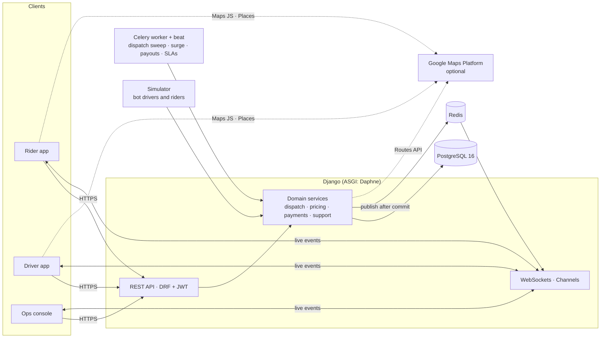

# Ride Pulse

**A full ride-hailing platform: rider app, driver app and operations console**, built on Django,
PostgreSQL and React. Riders book rides with upfront fares and track their driver live; drivers go
online, accept trip offers and start trips with a ride PIN; the operations team watches a live city
map, verifies drivers, tunes surge pricing, handles support and SOS alerts, and reads analytics.

It runs in three cities (Chennai, Bengaluru, Coimbatore) with a bot fleet that drives in real time,
so every screen has something happening the moment you open it.

| | |
| --- | --- |
| **Back end** | Python 3.12 · Django 5.2 LTS · Django REST Framework · Channels (WebSockets) · Celery |
| **Data** | PostgreSQL 16 (partial unique indexes, BRIN, ArrayField, `generate_series` reporting) · Redis |
| **Front end** | React 19 · TypeScript · Vite · Tailwind CSS · TanStack Query · Leaflet / Google Maps · Recharts |
| **API** | 123 REST operations, JWT auth, OpenAPI 3 docs (Swagger UI and ReDoc) |
| **Quality** | 149 tests (88% coverage) + Playwright browser tests + Locust load test · Ruff · strict TypeScript · GitHub Actions · Docker |
| **Ops** | Render blueprint · Sentry · Prometheus `/metrics` · JSON logs · installable PWA |

---

## Quick start

You need Python 3.12 (or [uv](https://docs.astral.sh/uv/)). PostgreSQL and Node.js are installed
into the project's virtualenv, so nothing else is required on the machine.

```bash
make setup     # venv + dependencies, local PostgreSQL, migrations, demo data, React build
make dev       # web server and bot simulator together → http://localhost:8000
```

Or with Docker (Postgres, Redis, web, Celery worker and beat, simulator):

```bash
docker compose up --build
```

### Demo accounts

All demo accounts use the password **`RidePulse@2026`** (created by `make seed`; the login page
has one-click buttons for each).

| Role | Email | Try |
| --- | --- | --- |
| Rider | `rider@ridepulse.dev` | Book a ride from T. Nagar to Marina Beach and watch a bot driver pick you up |
| Driver | `driver@ridepulse.dev` | Go online, tap the map to move, accept a trip, start it with the rider's PIN |
| Operations | `ops@ridepulse.dev` | Live map, trips, driver verification, surge overrides, analytics |
| Support | `support@ridepulse.dev` | Ticket queue, refunds, SOS safety desk |
| Admin | `admin@ridepulse.dev` | Everything, plus the audit trail and the Django admin at `/admin/` |

To play both sides yourself, open the rider app in one tab and the driver app in another: each tab
keeps its own sign-in, and opening an app with the wrong account offers a one-click switch. Put the
driver online near the rider's pickup, then book.

---

## What's inside

### Rider app (phone-style)
Map with nearby cars · "Where to?" search over landmarks, areas and saved places · set pickup or
drop by moving the map under a fixed pin (the address updates as it settles) · upfront fares
for Bike, Auto, Mini, Sedan and SUV with ETAs, surge badge and a line-by-line fare breakdown ·
UPI, card, cash or wallet · promo codes · live tracking with the driver's car moving on the map ·
4-digit ride PIN · in-trip chat with the driver (quick replies, unread badge, notifications; bot
drivers answer) · SOS · rating, tags and tips · PDF receipts · wallet top-ups and dues · help
tickets. Bottom sheets drag between peek, normal and full, with the Book button pinned.

### Driver app (phone-style)
Online/offline with compliance checks (expired documents or unpaid dues block going online) ·
surge zones on the map · trip offers with a chime, vibration and a 20-second countdown ring that
turns amber, then red · chat with the rider · navigate, arrive (only within
500 m of the pickup), start with the PIN, complete · cash-collection prompts · earnings by day,
week and month · payouts · document upload and vehicle registration · safety score and
acceptance rate.

**On a laptop or desktop** the rider and driver apps switch to a web layout: a full-screen map
with a side panel (booking, trip status, offers, chat), tabs in a header, and routes framed
beside the panel. Other screens become a centred column. "Phone view" in the header shows the
mobile design instead (remembered per device); phones always get the app layout.

Both apps install as a **PWA** (manifest, icons, a service worker that serves the app shell
offline and never caches live data). Regenerate the icons with `python scripts/make_icons.py`.

### Operations console (desktop)
KPI dashboard · live map of every car and trip (WebSockets with polling fallback) · trip detail
with timeline, GPS route and **dispatch decisions** (who was offered the trip and their ranking
score) · driver verification queue · suspend and reinstate drivers · block riders · surge board
with manual overrides · fare-card editing · promotions · support queue with SLA timers, internal
notes and refunds · SOS desk · payouts and a live ledger integrity check · analytics with a demand
heatmap · CSV export · field-level audit trail.

---

## How it works



Business logic lives in plain service functions (`apps/*/services.py`); API views, the simulator,
Celery tasks and the demo seeder all call the same functions, so behaviour is identical everywhere.

### Trip lifecycle

```
REQUESTED ─accept─▶ DRIVER_ASSIGNED ─arrive─▶ DRIVER_ARRIVED ─PIN─▶ IN_PROGRESS ─▶ COMPLETED
    │  ▲                  │                        │
    │  └─driver cancels───┘ (re-dispatched)        │
    ├─▶ NO_DRIVER_FOUND (5-minute timeout)         │
    └──────────────────────────────────────────────┴──▶ CANCELLED (fees by policy)
```

Every transition goes through one state machine (`apps/rides/workflow.py`) and is recorded on the
trip timeline and in the audit trail.

### Dispatch
* **Sequential (default):** candidates come from an index-friendly bounding box on online drivers
  plus an exact haversine distance computed *inside PostgreSQL*. They are ranked by pickup ETA plus
  small "virtual minute" penalties for low ratings, low acceptance and poor safety scores. The best
  driver gets a 20-second offer; declines and timeouts pass it to the next.
* **Batched:** each sweep solves one assignment problem over all open requests and free drivers in
  a city with the **Hungarian algorithm** (`apps/rides/hungarian.py`), minimising total pickup time
  instead of greedily matching one request at a time. It's tested against brute force.
* **Never double-booked:** partial unique indexes allow one active trip per rider and per driver,
  and one pending offer per driver, so even racing workers can't break the rules.

### Pricing
`fare = max(base + km × rate + minutes × rate + paid waiting, minimum) × surge + fees − promo + 5% GST`.
The engine (`apps/pricing/fare.py`) is pure and explains itself line by line. Fares are
**upfront**: the quoted price stands unless the real route is more than 20% longer, or 30% slower,
than estimated. Promotions are funded by the platform, so the driver's earning never shrinks.
**Surge** comes from demand (recent requests) against supply (free drivers) in each zone, smoothed
and capped at 3×; operations can override it for events.

### Money
Every rupee moves through a **double-entry ledger**: each transaction's entries sum to zero, and
wallet balances only change through entries. `GET /api/v1/ledger/` re-verifies both invariants
from the database. Cash trips leave the platform's share as driver dues; failed card payments
become rider dues; payments use **idempotency keys**; weekly payouts can fail and reverse cleanly.

### Real time
Services publish events only **after the database transaction commits** (`transaction.on_commit`),
so a client never hears about a state it can't read. Trip, driver and ops channels authenticate
with the session cookie or a JWT.

Without Redis, events still cross processes: they're published with PostgreSQL **`LISTEN/NOTIFY`**
(`apps/realtime/relay.py`), and each web process relays what it hears to its sockets. So a bot
driver moving in the simulator process reaches the rider's map in milliseconds. With `REDIS_URL`
set, the Redis channel layer does this instead. Every screen also polls as a fallback.

On the map, cars **glide** between GPS updates (each move lasts as long as the gap between
updates, so motion is continuous) and **turn smoothly**. During a trip the car is snapped onto the
route, the part already driven disappears, and the ETA counts the road that's left ("4.6 km left ·
drop by 5:49 pm"). Simulated drivers follow the same route line riders see. Nearby cars carry a
daily-rotating anonymous key, so they can be animated without revealing which driver is which.

### PostgreSQL features used
Partial unique indexes and partial indexes · BRIN indexes for append-only GPS pings and audit logs
· `ArrayField` · `DISTINCT ON` · `generate_series` + `FILTER` for gap-free time series · geohash
prefixes for demand heatmaps · haversine distance in SQL · `INSERT … ON CONFLICT … RETURNING` for
gap-free reference numbers · `SELECT … FOR UPDATE (SKIP LOCKED)` in dispatch.

---

## Google Maps integration

The platform works out of the box with **OpenStreetMap** and built-in route estimates. Add Google
Maps keys and it switches to Google, with no code changes:

| | Without keys | With Google keys |
| --- | --- | --- |
| Map tiles | OpenStreetMap (Leaflet) | Google Maps (`@vis.gl/react-google-maps`), light and dark |
| "Where to?" search | Ride Pulse landmarks and areas | **Google Places Autocomplete**: any address in India |
| Dropped pins | Nearest landmark or area | **Google reverse geocoding** |
| Trip distance and ETA | Straight line × 1.3 road factor, time-of-day speed profile | **Routes API**: real roads, live traffic |
| Route on the map | Smooth arc | **Actual road polyline** (stored with the trip) |

**Setup**
1. In the [Google Cloud console](https://console.cloud.google.com/google/maps-apis), create a
   project with billing, and enable *Maps JavaScript API*, *Places API (New)*, *Geocoding API* and
   *Routes API*.
2. Create two keys:
   * a **browser key** restricted to those browser APIs and your site's referrers
     (`http://localhost:8000/*`);
   * a **server key** restricted to the Routes API and your server's IP.
3. Put them in `.env` as `GOOGLE_MAPS_BROWSER_KEY` and `GOOGLE_MAPS_API_KEY` and restart.

**Built to fail safely.** If the server key fails or is slow (2.5 s timeout), trips fall back to
the built-in estimate. If Google rejects the browser key at runtime (bad key, billing disabled, or
an unauthorised domain), the apps switch to OpenStreetMap instead of breaking. Route lookups are
cached for 5 minutes per origin and destination.

**Cost.** Billing accounts in India get 70,000 free events per month for Dynamic Maps,
Autocomplete, Geocoding, Compute Routes (Essentials) and Route Matrix, and 35,000 for
traffic-aware Compute Routes (Pro). Beyond that, prices start at about $0.85–$3 per 1,000
([India pricing](https://developers.google.com/maps/billing-and-pricing/pricing-india); elsewhere
the free caps are 10,000 and 5,000, see
[global pricing](https://developers.google.com/maps/billing-and-pricing/pricing)). A portfolio demo
stays well inside the free tier. Check the current price lists before running real traffic.

---

## API

* Swagger UI: <http://localhost:8000/api/docs/> · ReDoc: `/api/redoc/` · schema: `/api/schema/`
* Authenticate with `POST /api/v1/auth/token/` and send `Authorization: Bearer <access>`.
* Errors share one envelope: `{"error": {"code", "message", "field", "details"}}`.

```bash
TOKEN=$(curl -s -X POST localhost:8000/api/v1/auth/token/ -H 'Content-Type: application/json' \
  -d '{"email":"rider@ridepulse.dev","password":"RidePulse@2026"}' | python3 -c 'import sys,json;print(json.load(sys.stdin)["access"])')

curl -s -X POST localhost:8000/api/v1/fares/estimate/ -H "Authorization: Bearer $TOKEN" -H 'Content-Type: application/json' \
  -d '{"pickup":{"lat":13.0418,"lng":80.2341},"dropoff":{"lat":13.05,"lng":80.2824}}'
```

Access is **capability-based**: roles map to capabilities (`trips.manage`, `payments.refund`, …)
in one place (`apps/accounts/roles.py`), views declare what each action needs, and anything
unmapped is denied. Riders and drivers only ever see their own records.

### More rider features
* **Share trip:** a public "follow my ride" link (`/track/<token>`) shows the car, driver and
  plate live, with no login; no phone numbers, PIN or fare, and it expires an hour after the ride.
* **Schedule a ride** up to 7 days ahead. A background job (`dispatch_scheduled_rides`, every
  minute, `SKIP LOCKED` so several workers never double-book) turns it into a normal trip
  request eight minutes before pickup, or tells the rider why it couldn't.
* **A stop on the way:** fares, distance and ETA cover both legs plus a stop allowance; road
  polylines are joined; bots drive through the stop.
* **Referrals:** invite links pre-fill the code; after the friend's first ride both wallets get
  ₹50 from the promotions budget, as one balanced ledger transaction, exactly once.
* **Boost and tips:** while searching, riders can add ₹10/20/30/50 (up to ₹100). It goes 100%
  to the driver (no commission or GST), widens the search, starts a new dispatch round so
  drivers who passed are asked again, and gives the request another minute. A tip promised at
  booking shows on the driver's offer and is collected with the fare (cash in hand for cash
  rides). Bot drivers say yes more often to boosted or tipped rides.
* **Invoice email after payment** (like Rapido): a numbered GST invoice (`INV-<year>-000001`)
  with the fare breakdown, route and times, driver and plate, payment, and the PDF attached,
  sent when the fare is paid (or once unpaid dues are cleared). Riders can view it in the app
  and send it again; phone-only riders add an email in Account.
* **Razorpay** for wallet top-ups (test or live keys in `.env`): the server creates the order,
  Checkout takes the payment, and the wallet is credited only after the HMAC signature is
  verified, by the browser callback or the `payment.captured` webhook, whichever is first.
* **Ride preferences and favourite drivers:** quiet ride, AC on, extra luggage and "woman
  driver preferred" (women drivers nearby are offered the trip first). Favourite drivers get a
  head start in dispatch when they're close.
* **Ride Pass:** ₹99 for 30 days; no booking fee and 10% off every ride (up to ₹30 a ride).
* **Split fare:** after a paid ride, ask friends by phone number; their share lands in the
  rider's wallet when they pay.
* **Price-drop alerts:** during surge, "tell me when prices drop" notifies the rider once
  (with a ready-to-book link) when the zone's surge ends, for up to 2 hours.
* **Lost and found:** up to 7 days after a ride the rider reports an item; the driver answers
  Found / Not in my car, masked calls reopen for 24 hours, and a support ticket tracks it until
  the item is handed back.
* **Tamil and Hindi:** the rider and driver apps switch language from Account (kept on the
  device); anything not yet translated shows in English.

* **Safety+ (Ride Check and Night Safe mode):** every minute the server watches trips in
  progress and asks "Is everything OK?" when the car has stopped for a while, gone well off the
  route, is running very late, or its location went silent (`rides.safety`). "Get help", or no
  answer within 3 minutes, opens a safety incident like SOS and alerts the rider's trusted
  contacts. Night Safe mode (10 pm – 6 am and "woman driver" rides) uses stricter limits,
  texts the live link to trusted contacts (up to 3: every ride, night rides, or only when shared),
  stops the driver ending the trip away from the drop unless the rider confirms, and adds an
  "I'm home safe" check-in. Ops see every check in the Safety desk.

* **When a ride type isn't available:** bike taxis run 5 am – 11 pm (service hours per ride
  type). If nobody of that type is near the pickup, or it's closed, the booking screen suggests
  the closest alternative (enough seats first, then a similar price) or lets the rider search
  anyway with a boost; after "no drivers available" the trip screen offers the same switch.
* **Bid your fare (like inDrive):** riders can offer 85% – 150% of the upfront price. Drivers
  accept, or counter with +₹10/20/30; counters appear live on the rider's search screen for two
  minutes while the search continues. The agreed difference is the driver's, outside commission.
* **Sure Ride:** for ₹5, "a driver at your pickup within N minutes or ₹30 back" (N = nearest
  ETA + 4). Late arrivals and no-driver-found are refunded to the wallet automatically.
* **Fair Share Meter:** every finished trip shows where the money went (driver, commission,
  each fee, discount, GST). Drivers see their real hourly earnings after estimated running costs.

* **Parcel delivery (like Rapido Parcel):** "Send a parcel" on Home. Bike drivers carry
  packages up to 10 kg (they can opt out). The sender adds the recipient, item type and weight;
  at pickup the recipient gets an SMS with a live tracking link and a 4-digit delivery code, and
  the driver can only mark it delivered with that code (wrong tries are counted and capped).

* **Hourly rentals:** a car and driver for 1/2/4/8 hours (10 km per hour included); no fixed
  drop, and extra km and minutes are added at the end (`rides.packages`).
* **Intercity (outstation):** from a served city to anywhere 40–600 km away, one-way or round
  trip for 1–7 days. Per-km pricing (minimum 100 km one-way, 250 km a day for round trips) plus
  a ₹300/day driver allowance that is all the driver's; car drivers can opt out of intercity.

* **Fare Lock:** from a finished ride, lock that route's normal price for a week (₹49) on
  chosen weekdays within an hour of the same time; surge never applies and Ride Pulse covers
  the difference as a discount, so the driver earns the same.
* **Language Bridge:** each user's app language is saved; chat messages arrive in the other
  person's language. Quick replies and common phrases use a built-in English/Tamil/Hindi
  phrasebook; free text is translated by Google Cloud Translation when
  `GOOGLE_TRANSLATE_API_KEY` is set (otherwise the original is shown).
* **Eco score:** each trip records CO₂ saved versus driving your own petrol car (by vehicle
  and fuel; EVs save most). 1 eco point per 100 g; 100 points = ₹10 in the wallet. Riders can
  prefer electric vehicles, which get a dispatch head start.

### More driver features
* **Daily goals:** ₹75 bonus at 5 trips and ₹125 more at 10, paid into earnings through the
  ledger (`DRIVER_GOALS`).
* **Going-home mode:** twice a day, for an hour, only trips that take the driver at least 1 km
  closer to their saved home are offered.

* **Driver Wellbeing:** after 6 hours of driving (pauses under 20 minutes don't count as rest)
  drivers get no new offers and are taken offline for a 20-minute break, with a warning 30
  minutes before; a proper break after 4+ hours pays a ₹10 rest bonus once a day.

### Production essentials
* **Phone login with SMS codes** (`/api/v1/auth/otp/…`): 6-digit codes stored only as HMACs,
  5-minute expiry, 5 tries, resend every 30 s and at most 5 an hour per number; new numbers
  sign up with just a name. SMS goes through Twilio or MSG91 (`SMS_BACKEND`); in development
  the code is logged and shown in the app.
* **Masked calling:** riders and drivers never see each other's number (only staff do). Calls
  go through Exotel click-to-call when configured (demo mode otherwise), are rate limited, and
  are logged on the trip for safety reviews.
* **Pickup verification** (`apps/rides/pickup.py`):
  * *Scan to start:* the rider shows a QR code that rotates every 30 s (an HMAC of the trip,
    its secret PIN and the time window), the driver scans it with the phone camera
    (BarcodeDetector, or jsQR on Safari). A screenshot stops working within a minute.
  * *The PIN is the fallback,* shown only once the driver is within 500 m, hidden until tapped,
    and read aloud on request. Five wrong PINs or codes lock the trip and alert the rider.
  * *Is this your car?* The rider checks the plate; "no" raises a safety incident at once.
  * *Together at the pickup:* the trip only starts with the driver at the pickup and, when the
    rider shares location, both phones within 150 m.
  * *After the start:* if the rider's phone and the car drift over 1 km apart, both are alerted
    (once). Locations from a device that's clearly elsewhere (a laptop demo) are ignored.
* **GPS-spoofing guard:** impossible jumps (over 1 km at over 150 km/h) aren't billed, and the
  trip is flagged for review.
* **Real driver GPS:** the driver app can follow the phone's location (`watchPosition`, sent
  every 15 m or 4 s) and keeps the screen awake while online.
* **Push notifications** (standard Web Push with VAPID keys, no Firebase account): urgent trip
  offers that expire with the offer, and trip updates for riders, even with the app closed.
  `python manage.py generate_vapid_keys`.

---

## Deploy

**Render (free plan):** push the repo to GitHub, then in Render choose *New → Blueprint* and pick
the repository. `render.yaml` creates the web service (Docker) and a PostgreSQL database; the
start script migrates, seeds demo data and runs the bot simulator next to the server. Real-time
updates work without Redis thanks to the PostgreSQL relay. Optional keys (Google Maps, Razorpay,
Sentry, metrics token) are set in the Render dashboard, never in git.

**Anywhere with Docker:** `docker compose up --build` runs the full stack (Postgres, Redis, web,
Celery worker and beat, simulator).

### Production checklist
* `python manage.py check --deploy` passes with `config.settings.prod` (HSTS, secure cookies,
  SSL redirect, `X-Frame-Options`, content-type sniffing off).
* **Errors:** set `SENTRY_DSN` to report exceptions (no personal data sent).
* **Metrics:** Prometheus scrapes `/metrics` with `METRICS_TOKEN`: request counts and latency
  histograms per view, plus live business gauges (trips by status, drivers by availability, open
  tickets, scheduled rides waiting, ledger balanced).
* **Logs:** `LOG_FORMAT=json` writes one JSON object per line, each tagged with the request id
  that is also returned as `X-Request-ID`.
* **Load:** 30 concurrent riders against the dev server: 0 failures, median 15 ms, p95 140 ms
  (login dominates, by design: password hashing is slow on purpose).

---

## Development

```bash
make help        # all commands
make test        # 149 tests (unit, integration on PostgreSQL, API, WebSocket, seed)
make e2e         # browser tests: Playwright drives Chromium through a full trip
make loadtest    # Locust: 50 riders browsing fares and cars for a minute
make lint        # Ruff + TypeScript type-check
make check       # everything CI runs, plus migration and OpenAPI checks
make frontend-dev   # Vite with hot reload on :5173, proxying the API to :8000
make reset       # wipe and reseed the demo (three weeks of history in about 40 s)
```

| Path | What lives there |
| --- | --- |
| `apps/rides` | trip model, state machine, dispatch, Hungarian assignment, receipts |
| `apps/pricing` | fare engine, surge, promotions, fare cards |
| `apps/payments` | double-entry ledger, wallets, gateway, payouts |
| `apps/drivers` · `apps/riders` | onboarding, documents, availability, GPS, safety score |
| `apps/support` | tickets, SLAs, refunds, SOS incidents |
| `apps/geo` | cities, zones, landmarks, routing, Google Routes client, geohash |
| `apps/realtime` | WebSocket consumers, broadcasting, PostgreSQL LISTEN/NOTIFY relay |
| `apps/analytics` | KPIs, time series, heatmaps, CSV export |
| `apps/audit` · `apps/notifications` | audit trail with field diffs, in-app and email notifications |
| `apps/simulation` | demo-history seeder and the live bot simulator |
| `frontend/src` | React apps: `pages/rider`, `pages/driver`, `pages/ops`, map abstraction in `components/map` |

Fares, drivers, riders and trips are simulated; payments go through a mock gateway (any UPI ID
containing `fail` is declined, to exercise the failure path).
